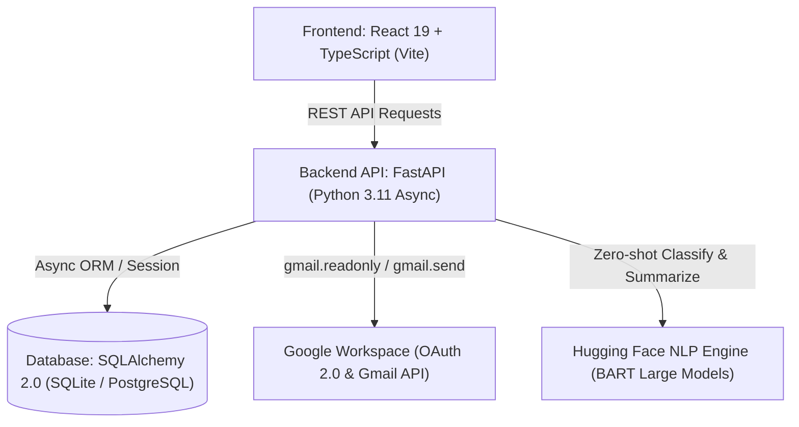
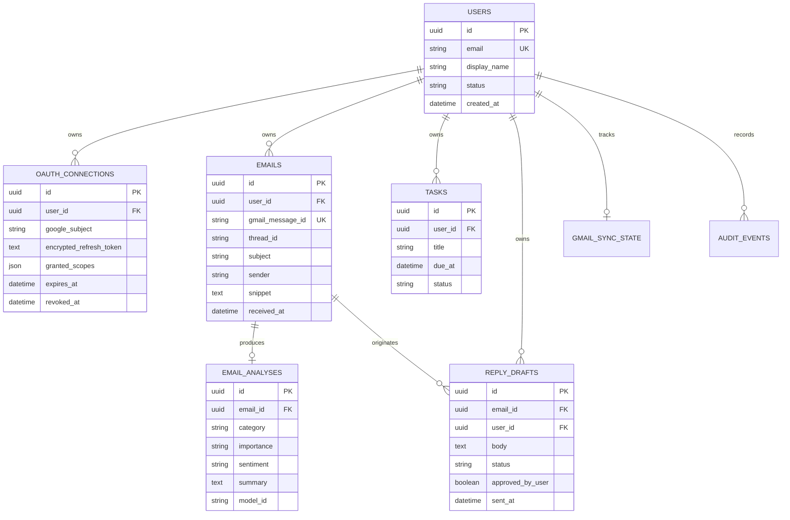
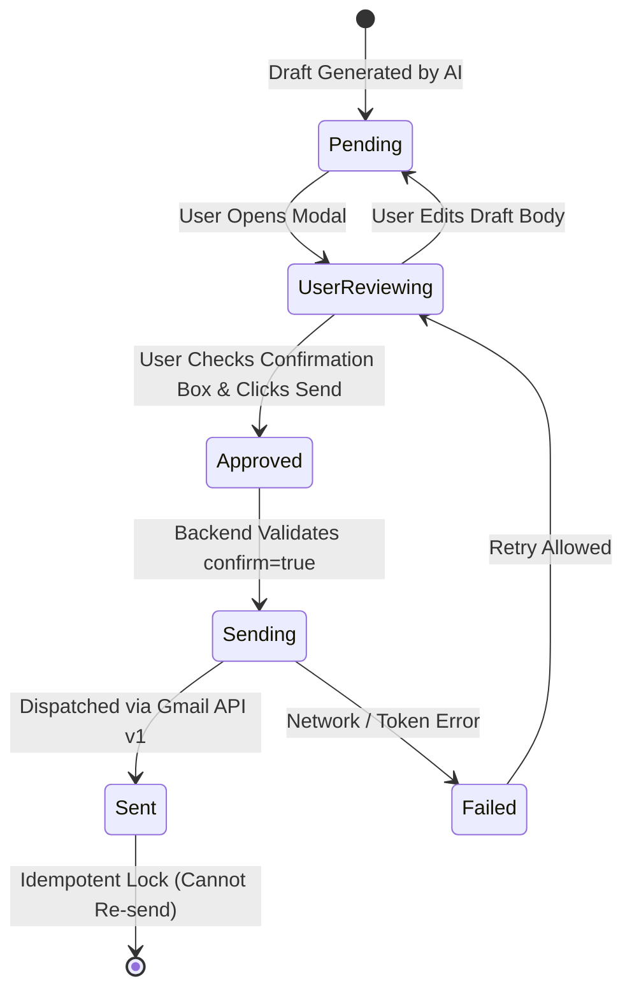

# AI Email Copilot — Technical Architecture & System Documentation

## 1. Executive Summary & Overview

**AI Email Copilot** is an enterprise-grade, privacy-centric email productivity platform designed to assist professionals with high-volume Gmail workflows. The application connects directly to Google Workspace via OAuth 2.0, ingests messages asynchronously, performs natural language understanding (NLU) with Hugging Face models, extracts actionable deadlines, and composes intelligent reply drafts.

### Core Value Propositions
- **Executive Summarization & Categorization**: Distills long email threads into concise, two-sentence action summaries and classifies emails into functional buckets (*Work*, *Action Required*, *Financial / Billing*, *Personal*, *Newsletter / Marketing*).
- **Automated Task & Deadline Extraction**: Discovers explicit deadlines and action items embedded in messages and populates an interactive task board.
- **Strict Human-in-the-Loop Guarantee**: Enforces an explicit manual review and approval state machine before any email is dispatched. **Zero autonomous email sending.**
- **Enterprise Privacy & Data Sovereignty**: Features one-click complete data purging (cascading deletion of all stored messages, drafts, analyses, and OAuth credentials).

---

## 2. Technical Stack Architecture

| Layer | Component | Technologies & Specifications |
| :--- | :--- | :--- |
| **Frontend** | Single-Page Application (SPA) | React 19, TypeScript, Vite, Lucide React Icons, Native CSS Design System |
| **Backend API** | High-Performance REST Service | FastAPI (Python 3.11), Uvicorn ASGI Server, Pydantic v2 validation |
| **Database** | Relational Persistence | SQLAlchemy 2.0 (Asyncio), SQLite (`aiosqlite`) / PostgreSQL (`asyncpg`) |
| **Security** | Encryption & Token Handling | Fernet Symmetric Encryption (AES-128-CBC + HMAC-SHA256), HMAC CSRF State |
| **AI / NLP** | Machine Learning Pipeline | Hugging Face Transformers (`facebook/bart-large-mnli`, `facebook/bart-large-cnn`) |
| **External APIs** | Cloud Services | Google OAuth 2.0, Gmail REST API v1, Google Cloud Pub/Sub Webhooks |

---

## 3. Database Schema & Entity Relationships

The data model is designed with strict foreign key constraints and cascading deletes to uphold privacy standards.

---

## 4. Key Workflows & State Machines

### 4.1. Google OAuth 2.0 Authentication & Token Storage
1. **Initiation**: The frontend calls `GET /api/v1/auth/google/login`.
2. **CSRF State Generation**: The backend generates a cryptographically signed HMAC-SHA256 nonce embedding a timestamp and salt (`oauth_service.generate_state()`).
3. **Consent Screen**: User authorizes the restricted scopes:
   - `openid`, `email`, `profile`
   - `https://www.googleapis.com/auth/gmail.readonly` (reading messages)
   - `https://www.googleapis.com/auth/gmail.send` (sending approved replies)
4. **Callback & Token Exchange**: Google redirects to `/api/v1/auth/google/callback?code=...&state=...`.
5. **Token Encryption**: The refresh token is encrypted using Fernet symmetric encryption and saved to the database. The plain-text refresh token is never stored.

---

### 4.2. Ingestion & Natural Language Processing Pipeline
1. **Sync Request**: Triggered via `POST /api/v1/emails/sync?user_email=...`.
2. **Message Extraction**: The Gmail API is queried for the most recent message batches. Payloads are unpacked, decoding MIME multipart boundaries and sanitizing raw text.
3. **Prompt Injection & Input Sanitization**:
   - Email text is treated as **untrusted user input**.
   - Text is bounded to a 4,000 character limit.
   - Known prompt injection prefixes (e.g., `ignore previous instructions`, `system:`) are scrubbed before evaluation.
4. **Classification & Sentiment**: `facebook/bart-large-mnli` categorizes the message into *Work*, *Action Required*, *Financial / Billing*, *Personal*, or *Newsletter*.
5. **Executive Summarization**: `facebook/bart-large-cnn` extracts key narrative sentences into a high-level briefing.
6. **Task & Deadline Extraction**: Pattern and temporal extractors detect requests (*"please review"*, *"due by Friday"*) and compute exact target due dates.

---

### 4.3. Human-in-the-Loop Reply Safeguard State Machine

- **Explicit Payload Requirement**: Calling `/api/v1/replies/{id}/approve` without `{"confirm": true}` is rejected immediately with HTTP 400.
- **Idempotency Guard**: Once a draft enters `sending` or `sent` status, all duplicate requests are blocked to prevent accidental double-sends.

---

## 5. Security & Privacy Safeguards

1. **At-Rest Token Encryption**:
   - Refresh tokens are encrypted with Fernet (AES-128 in CBC mode with PKCS7 padding, authenticated using HMAC with SHA256).
   - Encryption keys are kept in `.env` and loaded at runtime.
2. **Least Privilege OAuth Scopes**:
   - The application does not ask for full mailbox write/delete access (`gmail.modify` or `mail.google.com`). It strictly requests `gmail.readonly` and `gmail.send`.
3. **Immutable Audit Trail (`audit_events`)**:
   - Every OAuth connection, disconnection, email sync batch, and outbound email dispatch is permanently recorded with a timestamp and metadata.
4. **Right to be Forgotten (Account Purge)**:
   - Calling `DELETE /api/v1/auth/user/delete-data` revokes tokens with Google's revocation servers and triggers cascading SQL deletion across all user data, leaving zero orphaned records.

---

## 6. Complete API Endpoint Reference

### Authentication & Authorization
| Method | Path | Description |
| :--- | :--- | :--- |
| `GET` | `/api/v1/auth/google/login` | Generates Google OAuth consent URL with CSRF protection |
| `GET` | `/api/v1/auth/google/callback` | Exchanges authorization code, stores encrypted tokens, returns HTML redirect |
| `GET` | `/api/v1/auth/status` | Returns current connection status, granted scopes, and token validity |
| `POST` | `/api/v1/auth/google/disconnect` | Revokes Google tokens and marks connection revoked |
| `DELETE` | `/api/v1/auth/user/delete-data` | Permanently purges user account and all related data |
| `GET` | `/api/v1/auth/audit` | Retrieves security audit logs for the user |

### Email & AI Processing
| Method | Path | Description |
| :--- | :--- | :--- |
| `GET` | `/api/v1/emails/` | Lists stored emails with pagination, category filter, and search |
| `POST` | `/api/v1/emails/sync` | Manually triggers synchronization with Gmail inbox |
| `GET` | `/api/v1/emails/{email_id}` | Retrieves a single email with full AI analysis metadata |

### Tasks & Deadlines
| Method | Path | Description |
| :--- | :--- | :--- |
| `GET` | `/api/v1/tasks/` | Lists extracted action items (filterable by `pending`/`completed`) |
| `PATCH` | `/api/v1/tasks/{task_id}` | Updates task status or title |
| `DELETE` | `/api/v1/tasks/{task_id}` | Deletes a task from the user's board |

### AI Reply Drafts & Safeguards
| Method | Path | Description |
| :--- | :--- | :--- |
| `GET` | `/api/v1/replies/` | Lists generated reply drafts for a specific email or user |
| `POST` | `/api/v1/replies/generate` | Triggers Hugging Face AI to compose a contextual draft |
| `PATCH` | `/api/v1/replies/{draft_id}` | Allows user to modify the suggested draft text |
| `POST` | `/api/v1/replies/{draft_id}/approve` | **Protected**: Requires `{"confirm": true}` to dispatch via Gmail |

